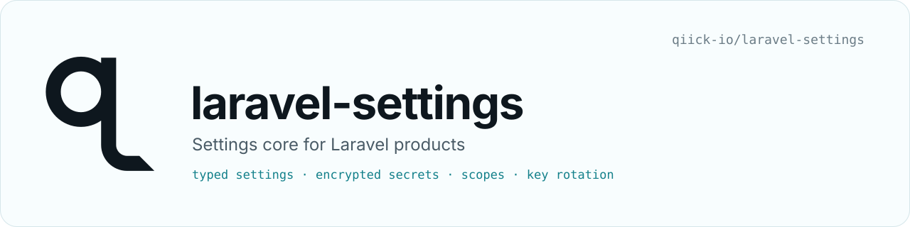

<p align="center">
  <picture>
    <source media="(prefers-color-scheme: dark)" srcset=".github/assets/header-dark.svg">
    <source media="(prefers-color-scheme: light)" srcset=".github/assets/header-light.svg">
    
  </picture>
</p>

# qiick/laravel-settings

[](https://scorecard.dev/viewer/?uri=github.com/qiick-io/laravel-settings)

PHPStan at `max` and the existing CI checks cover PHP. CodeQL covers GitHub Actions and JavaScript/TypeScript.

Scoped, typed settings and encrypted secrets for qiick Laravel products.

> **Pre-release.** `0.1.0-beta.1` is on Packagist for qiick products. Public APIs and the storage schema can change before 1.0.0. See the [upgrade guide](UPGRADING.md) before adopting it in a product with existing settings.

## Requirements

PHP 8.3 or later in the 8.x series, and Laravel 12 or 13.

## Installation

Install the beta from Packagist in your Laravel application.

```bash
composer require qiick/laravel-settings:^0.1@beta
```

## Configuration

Publish the configuration if the application needs to override a default. Run the migrations before the deploy check.

```bash
php artisan vendor:publish --tag=settings-config
php artisan migrate
php artisan settings:check
```

## Declaring settings

Implement `Qiick\Settings\SettingsSchema` and tag the implementation in your Laravel service provider with `SettingsSchema::class`. Declare each setting key once across all tagged schemas.

```php
return [
    Definition::bool('two_factor_required')->default(false),
    Definition::json('sidebar_modules')->default(fn () => ['overview' => true]),
    Definition::enum('password_policy', PasswordPolicy::class)->default(PasswordPolicy::Required),
    Definition::string('oidc_client_secret')->secret(),
];
```

Definitions use the `app` group and allow only the `instance` scope by default. Use `in()` and `scopes()` to opt into other groups and scopes. Closures supply defaults on demand.

`json()` accepts PHP lists and associative arrays. An enum definition accepts instances of the declared backed enum and stores their backing values. A stored backing value that fails validation falls back to the default and reports `SettingTypeMismatch`.

Secret definitions use `string()->secret()` and have a null default. The package reads secrets from encrypted database values. Products that provide their own environment fallback handle it in application code.

## Reading and editing settings

Resolve `Qiick\Settings\Settings` from the Laravel container. Typed reads use the stored value or the declared default. Ordinary group reads omit secrets, and `forEdit()` exposes a `has_<key>` flag. Call `secret($key)?->reveal()` when the caller needs plaintext.

Typed reads throw `InvalidArgumentException` for an undeclared key, a type or enum mismatch, or a scope the definition does not allow. When a stored non-secret value fails validation, the reader reports `SettingTypeMismatch` and returns the declared default.

After a `set()` or `forget()` commits, `SettingsUpdatedEvent` carries the scope, group and changed key names.

Read the group's `revision($group, $scope)` before reading its edit values. Pass that revision as `expectedRevision` to `set()` when saving. A conditional write targets one group and throws `StaleSetting` if another write changed its revision. The revision is monotonic across writes and clears. An empty group starts at zero.

`forget()` clears the stored value and advances the revision, so subsequent reads use the default. An unconditional `set()` can update several groups in one transaction.

## Request and job memoization

Each request or job reads committed settings from the database and reuses the result for that group within the same scope. Reads inside a transaction go directly to the database. Writes invalidate the memo after the outer transaction commits. The memo holds only ciphertext for secret settings. A fresh request or job sees changes committed by other processes.

## User erasure

Resolve `Qiick\Settings\Erasure\SettingsEraser` from Laravel in the product's erasure orchestrator. A full erasure deletes the user's settings and clears their request or job memo after commit. User settings are global. Call the eraser only for full erasure requests. See the [public API](docs/public-api.md#classes) for arguments and reporting.

## Maintenance commands

`settings:verify` checks declared keys, scopes and stored encryption. During key rotation, put the old key in Laravel's `APP_PREVIOUS_KEYS`. Use `settings:reencrypt --dry-run` to count rows that use a previous key, then run `settings:reencrypt` to update them.

```bash
php artisan settings:export > settings.json
php artisan settings:import settings.json --dry-run
php artisan settings:import settings.json
```

The JSON export contains ciphertext bound to the current `APP_KEY`. Treat it as a database backup and protect it accordingly. Use the same key and declared schema when restoring. The import validates the entire file before writing and restores revision, metadata and timestamps in one transaction on an empty `settings` table. Dry run validates the file without changing storage.

## Threat model

**Assets.** Product configuration that changes security behaviour (two-factor requirements, password policy, alert routing) and the secrets stored next to it (OIDC client secrets, webhook and API credentials).

**Trust boundaries.** Values written through `Settings::set()` come from product code, often from an admin form: the package treats the key, scope and value as untrusted and validates them against the declared schema. The product decides who may edit which scope (its Policies). The application's `APP_KEY` and database credentials are trusted.

| Threat | Control | Checklist |
| --- | --- | --- |
| Duplicate instance rows through a `NULL` scope ID | `scope_id` is never null; unique natural key (scope, scope ID, group, key) with case-sensitive identity on every engine | S1 |
| A secret leaks into a page, log, exception or memo | `forEdit()` exposes `has_<key>` only; `Secret` redacts every representation; the memo holds ciphertext | S2 |
| A declared secret is stored in plaintext | writes encrypt (`encryption = laravel-v1`); `settings:verify` fails on a plaintext row | S3 |
| Mass assignment of arbitrary keys | writes refuse undeclared keys and keys outside the definition's scopes | S4 |
| Scope confusion | unregistered scopes and non-empty IDs for instance-like scopes are refused; authorization stays in the product Policy | S5 |
| Stale security settings in workers | per-request or per-job memo, refreshed from committed data | S6 |
| A rolled-back write poisons the memo | the memo is invalidated after the outer commit only | S7 |
| Lost update between two admins | group revision with `expectedRevision`, and 64 ordered write-lock buckets (`crc32` of scope, ID and group) that serialise writers even before a group's first row exists | S8, `SettingsWriteRaceTest` |
| Key rotation breaks secrets | `APP_PREVIOUS_KEYS` keeps them readable; `settings:reencrypt` moves rows under the group lock | S9 |
| An undecryptable secret enables a default (fail open) | strict mode throws `UndecryptableSetting`; non-strict reads it as absent | S10 |
| A partial write or restore | multi-group writes, archive imports and the eraser each run in one transaction; an import validates the whole file before writing | `SettingsRuntimeTest`, `SettingsArchiveTest` |

**Out of scope, owned by the product.** Authorization of who edits which scope, environment-variable fallbacks for secrets, protection of `settings:export` files (they hold ciphertext bound to `APP_KEY`), database backups, and the `APP_KEY` itself: anyone holding it and the database can read every secret.

How each design standard is met: [docs/standards-traceability.md](docs/standards-traceability.md).

- [Public API and deprecation policy](docs/public-api.md)
- [Security policy](SECURITY.md)
- [Reference schema](docs/reference-schema.md)
- [Upgrade guide](UPGRADING.md)

## License

[MIT](LICENSE)
